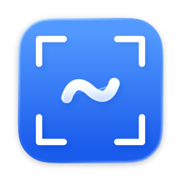

<p align="center">

<br>
<a href="https://github.com/noorvir/tilde/releases/latest"></a>
<a href="https://github.com/noorvir/tilde/actions/workflows/ci.yml"></a>

</p>

## About

`tilde` is a macOS app for giving feedback to coding agents. Instead of describing a problem in words, you point at it on the screen. It works on any app and uses accessibility data where available. Tilde does the following:

- **Annotate any element** in any app, with a note attached
- **Draw** arrows, boxes and free lines on top of the screen
- **Sketch wireframes** to visually communicate a screen or component
- **Record** a display, a window or a connected iPhone
- Works with **any MCP agent** (Claude Code, Codex, Cursor, Gemini CLI, …)
- Works with agents on **remote machines** over ssh (beta)

## Install

Download the DMG from the [latest release](https://github.com/noorvir/tilde/releases/latest) and move Tilde to Applications. Tilde updates itself after that.

Requires macOS 14 or later.

To build from source you need Xcode and Go:

```
git clone https://github.com/noorvir/tilde.git
cd tilde
scripts/install-app.sh
```

## Usage

Open Tilde from the menu bar and connect your agents in the **Agents** menu.

When an agent needs your feedback, it calls the `start_annotation` MCP tool and Tilde opens over your screen. Click on things, write notes, draw, and press **Send**. The agent gets back a report with your notes and a screenshot of each element you pointed at.

You can also open Tilde yourself by pressing Control twice.

## How it works

Tilde runs a local MCP server on your Mac, and authenticates each request with a token. When you connect an agent, Tilde adds this server to the agent's config.

When you point Tilde at an element on your screen, it reads it through the macOS Accessibility API (and the DOM in Tilde's own browser) and takes a screenshot. It collects all the annotations into a report and passes it back to your agent, if the flow was started by it, or copies it to your clipboard for you to paste it manually. This also works for remote machines.

### Remote machines (beta)

> [!WARNING]
> Remote machines are in beta and are off by default. Turn them on only for machines that you own and trust.

Tilde copies a small proxy to a machine that you can reach over ssh, and connects it to Tilde over your ssh connection. Agents on that machine use the proxy as their MCP server. This means that a program on that machine can open Tilde on your screen and receive what you send.
